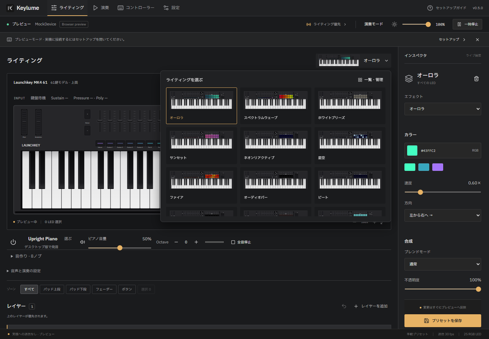
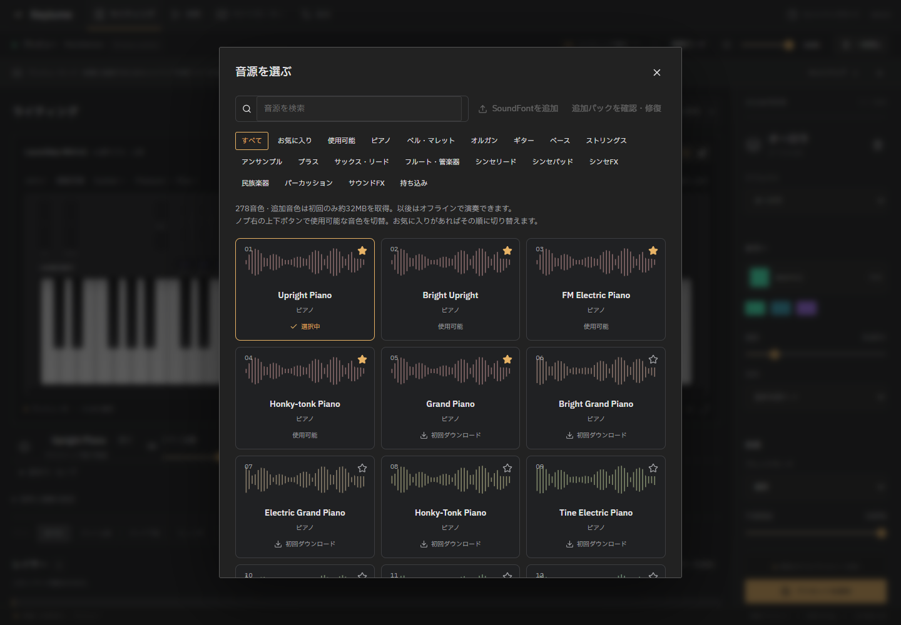
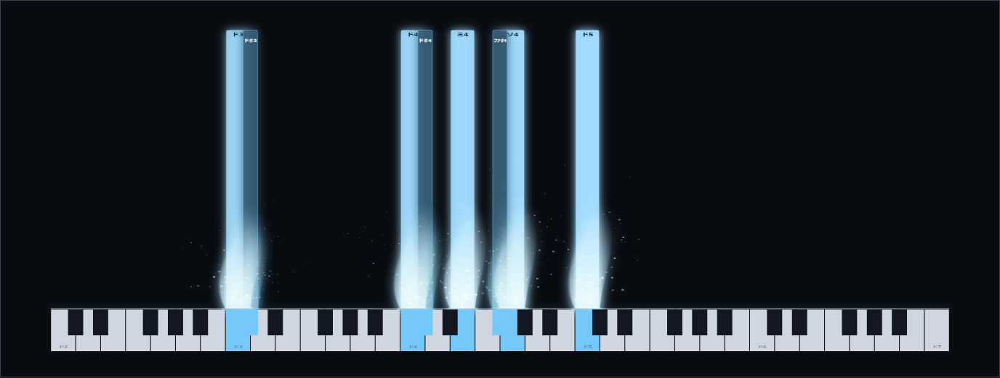

# Keylume for Windows

Launchkey MK4 61 向けの非公式ライティングコントローラー＆常駐演奏アプリ。Tauri 2 + Rust + React で、ウィンドウを閉じても演奏とライティングを続けます。

**v0.8 は実機受け入れ未完了のプレビュー版です。** 初期状態は MockDevice。実機の動作、DAW ごとの共存、スリープ復帰、72 時間連続稼働は、同梱の受け入れチェックリストで確認してください。Novation / Focusrite とは関係ありません。

## 起動

[Windows インストーラー](https://github.com/lingmulongtai/Keylume/releases/download/v0.8.1/Keylume_0.8.1_x64-setup.exe)を実行してください。[ポータブル ZIP](https://github.com/lingmulongtai/Keylume/releases/download/v0.8.1/Keylume_0.8.1_windows-x64.zip)は展開して `Keylume.exe` を起動します。Windows 11 と WebView2 Runtime が必要です。コード署名はしていません。

Mac 版は独立した [Keylume-macOS](https://github.com/lingmulongtai/Keylume-macOS) で開発・配布しています。



1. 起動してデバイスプレビューを確認します。
2. 「設定 → デバイス」で **MockDevice でプレビュー** を OFF にすると、Launchkey MK4 61 の DAW ポートを探します。
3. 「設定 → 共存設定」で、ライティング優先または DAW に譲るを選択します。
4. LED マップ検証で、RGB ID、単色ボタンの種類、B3 / 93 の違いを確認します。
5. ウィンドウを閉じると常駐します。終了するときは、Mac ではメニューバー、Windows ではトレイの Keylume メニューで「終了」を選びます。

鍵盤とノブには LED がありません。キャンバスの鍵盤ハイライトは画面上だけの表示です。

## ホームで音源を試す

「テスト演奏」でデモ曲を選んで再生すると、その音源の演奏に合わせて鍵盤が動きます。内蔵曲は静かな分散和音の **Rain on Glass**、スウィングの **Pocket Swing**、三拍子の **Lantern Waltz**。自分のMIDIファイルを開くと、ファイル名から曲名が入ります。そのまま確定するか、好きな曲名に変更できます。ホームと「演奏」タブは同じ曲と再生位置を使います。別の曲を選ぶと、読み込み中の曲が切り替わります。物理モデリング音源を試すには「選ぶ」で **Modeled Grand** に切り替えてください。

## ピアノを弾く

ホーム画面の **Upright Piano の電源**をオンにしてください。物理モデリング音源 **Modeled Grand** と4種類のサンプル音源を同梱しているため、DAWや追加インストールは不要です。ベロシティ、サステインペダル（CC64）、本体のOctave変更、アプリの追加オクターブ、音量、出力デバイス選択に対応。設定を保存し、ウィンドウを閉じても使えます。[詳しい使い方と対応範囲](docs/piano.md)

「選ぶ」で音源カードを開くと、グランドピアノ、シンセ、パッド、ストリングスなど追加274音色を選べます。初回だけ約32MBを取得し、その後はオフラインで使えます。自分のSF2もインポートできます。本体の8ノブではリバーブなどの音作りを操作できます。



## 本体を自分のコントローラーにする

「コントローラー」で演奏用とデスクトップ用の割り当てを別々に保存できます。右端のフェーダー下ボタンでモード切替。上下ボタンで音色／キット、中央の左右でライティングを選べます。Undo、ショートカット、メディア、アプリ／URL起動、Pitchホイールのスクロールにも対応します。[初期割り当てと変更方法](docs/controller.md)

Mac でキー操作やスクロールを使う場合は「システム設定 → プライバシーとセキュリティ → アクセシビリティ」で Keylume を許可します。Undo の標準割り当ては `Cmd+Z` です。アプリの起動先には `.app` を選べます。

## 演奏画面・MIDI練習・ルーパー

**演奏**タブで、弾いた音の軌跡を表示したり、MIDIファイルから降ってくる音符に合わせて練習できます。標準は曲のテンポで進むタイミング採点。正しい音まで待つモードにも切り替えられます。

表示するモニターを選び、鍵盤の左右端と高さをドラッグで調整すると、2画面をまたぐ演奏画面になります。背景を透明にしてデスクトップに重ねたり、バーと鍵盤を隠して火花だけを表示できます。10種類の演出、黒鍵／白鍵の明暗と幅、英語／ドレミの音名に対応します。**パッドドラムとルーパー**では6キットと各パッドの音作り、録音、重ね録り、Undoが使えます。[使い方と制約](docs/performance.md)



## 実装した機能

- 公式の61鍵モデルに合わせた本体図。16 パッド、9 フェーダーボタン、17 単色候補、61 鍵、8エンコーダーを描画。選択、範囲選択、ペイント、200%までの拡大。
- つまみ・フェーダー・ホイール・鍵盤・パッド・DAWボタン・ペダルのライブ表示。Playは緑、Recordは赤。受信したArp/Scale、Touch、圧力にも対応。
- サンプル不要の物理モデリング・ピアノ Modeled Grand。打鍵の強弱に応じた音色、ハンマーの硬さ・弦の余韻・共鳴の調整。
- 4種類の内蔵CC0ピアノ、128ボイス、サステイン、±3オクターブ、音量・出力・バッファ設定、全音停止、DAW使用中の自動消音。
- 追加274音色のオンデマンド取得、音源カード、検索・お気に入り、SF2インポート、8種類のリアルタイム音声エフェクト。
- 演奏／デスクトップ別の操作割り当て、MIDI Learn、ショートカット、メディア、アプリ起動、連続スクロール。
- 選択したハードウェアフェーダーでピアノ音量を操作。出力先を「設定」から選択し、OS の既定出力変更に自動追従。
- 演奏ノートの軌跡、光・粒・音ごとのカラー、音域と鍵盤位置調整、複数モニターへの連続表示。
- MIDI形式0/1読込、テンポ変更、トラック選択、タイミング採点／待機、速度・遅延補正・区間リピート。
- 6キット・16パッドの編集可能な合成ドラム、1/2/4/8小節の録音・重ね録り・再生・停止・消去・8段階Undo、4拍カウントインとクリック。
- 装飾を抑えた編集UI、上部ナビゲーション、エディターとプリセット一覧の共通本体図。
- 起動時と12時間ごとの更新確認、手動確認、新バージョンの案内。Preview版の通知と自動確認を設定可能。
- 18 エフェクト、5 ブレンド、ゾーン、不透明度、輝度・彩度・色温度・ガンマ、0.5 秒の切替。
- 35 プリセット定義（34種類の通常ライティングと本体デモ）、複製・保存・削除・検索、`.keylume.json` 入出力、schema 0 → 1 移行。
- Rust の常駐描画、差分送信、LED アドレスごとの最新値を保つ送信スレッド、トレイ、単一インスタンス、自動起動。
- DAW プロセス監視、ハンドオフ、入力転送、ノート / CC / チャンネルの変換、ポート再接続、転送停止時のノート解放。
- 前面アプリ / プロセス / 時間帯 / アイドルのプロファイル、手動固定、夜間・ロック時の減光。
- Windows 版では再生音に合わせて LED や OLED を動かせます（WASAPI ループバック、FFT 2048、8 バンド）。
- OLED の ASCII テキスト、時計、1bit 画像、スペクトラム。画像は ACK 待ち・最大 10 fps・タイムアウト時は画像だけを停止。連続切替は最新の表示にまとめ、出力待ちで描画を止めません。
- LED 検証、レイアウト編集・書き出し、MIDI モニタ、設定バックアップ、初回セットアップ案内。

現在の対応範囲と未実装項目は [実装状況](docs/implementation-status.md) を参照してください。「本体デモ」は非揮発設定の未検証値を含むため、自動プリセット切替から実行せずデバイス画面の明示操作に限定しています。

## 更新

**v0.1.0からはv0.7.0を一度手動でインストールしてください。** v0.2以降は新しいWindows版を検出すると、アプリ内またはトレイ常駐時に案内します。Mac 版は Universal DMG を含む新しいリリースを案内します。「更新ページを開く」からダウンロードしてインストールできます。自動確認は設定でオフにできます。[更新確認の詳細](docs/updates.md)

プリセットと設定はそのまま保持します。旧既定レイアウトは61鍵モデルの配置へ移行し、LEDアドレス・種類・検証状態を保持します。座標を編集したカスタムレイアウトは維持します。[本体図と移行仕様](docs/device-layout.md)

## DAW と同時に使う

ライティング優先では、DAW の Launchkey ネイティブ制御サーフェスを解除します。鍵盤の MIDI 入力を有効にし、パッドとコントロールはユーザー作成のループバックで転送します。

Mac では「Audio MIDI 設定 → ウインドウ → MIDI スタジオを表示」で IAC ドライバを開き、オンラインにします。パッドとコントロール用のバスを 1 本ずつ作り、Keylume の「共存設定」で出力に、DAW で同じバスを入力に指定します。[Apple の IAC 設定手順](https://support.apple.com/ja-jp/guide/audio-midi-setup/ams1013/mac)

通常の Windows MIDI Services のループバックは **A 出力 → B 入力** の対です。Keylume で A 側を、DAW で B 側を選んでください。Windows の `midir` は仮想ポートを作成しないため、自動作成は行いません。サービス稼働だけで WinMM のマルチクライアント対応を保証できません。

- [Microsoft: 導入方法](https://microsoft.github.io/MIDI/get-latest/)
- [Microsoft: 仮想ループバック](https://microsoft.github.io/MIDI/kb/virtual-loopback/)
- [Microsoft: 既存 MIDI API との互換性](https://microsoft.github.io/MIDI/kb/api-back-compat/)
- [Novation: Programmer's Reference v3](https://fael-downloads-prod.focusrite.com/customer/prod/downloads/launchkey_mk4_programmer_s_reference_guide-pdf-en_0.pdf)

## 開発

Node.js 22.12 以降と Rust 1.95 を使用します。Mac は Xcode Command Line Tools、Windows 11 は MSVC C++ Build Tools と WebView2 Runtime が必要です。

```powershell
npm ci
npm run desktop      # Rust コア + WebView
npm run dev          # ブラウザーで UI プレビューのみ
npm run package      # Mac は .app と DMG、Windows は NSIS インストーラー
```

ブラウザー版は実機 MIDI、ピアノの発音、OS プロセス監視、音声ループバック、自動起動を行いません。保存先も native 版とは独立した localStorage です。実機と同じフレームを表示するのはデスクトップ版です。

Mac で両方の CPU に対応する版を作る場合は、次を実行します。DMG は `src-tauri/target/universal-apple-darwin/release/bundle/dmg/` に生成されます。

```sh
rustup target add aarch64-apple-darwin x86_64-apple-darwin
npm run package -- --target universal-apple-darwin
```

## 検証

前回の確認範囲は [v0.6.1検証記録](docs/verification-v0.6.1.md)、その前の確認とコミット一覧は [v0.6.0検証記録](docs/verification-v0.6.0.md)、機能全体の記録は [v0.5.0検証記録](docs/verification-v0.5.0.md) にまとめています。掲載画像はv0.5.0のUIのブラウザープレビューです。

GitHub Actions はこのリポジトリで Windows 版をビルドして自己テストを実行します。`main` に含まれる `v*` タグが検証を通過すると、このリポジトリの Releases に配布物を公開します。

```powershell
npm test
npx playwright test  # Windows は Microsoft Edge、Mac は Playwright Chromium を使用
npm run build
cargo test --manifest-path src-tauri/Cargo.toml
cargo clippy --manifest-path src-tauri/Cargo.toml --all-targets -- -D warnings
cargo fmt --manifest-path src-tauri/Cargo.toml --check
```

ネイティブの常駐処理を実機なしで確認する自己テスト:

```powershell
.\artifacts\Keylume.exe --tray --self-test C:\Temp\keylume-smoke.json
```

自己テストは指定した JSON と隣接する `.data` フォルダに結果を保存し、接続、停止・再開、DAW 譲渡、DAW 終了、切断・再接続、保存を MockDevice で確認して終了します。既に起動中の Keylume を終了してから実行してください。

## 保存場所と構成

設定の保存先は Mac が `~/Library/Application Support/app.keylume.desktop/`、Windows が `%APPDATA%\Keylume\` です。`settings.json`、`performance.json`、`presets/`、`profiles/`、`layouts/layout.json`、`logs/` を使用します。正常な前回値は `.json.bak` に保持します。破損ファイルは `.corrupt-*` に隔離します。

- `src-tauri/src/engine.rs`: レンダリングとエフェクト
- `src-tauri/src/device/`: プロトコル、Mock / hardware、非同期送信
- `src-tauri/src/desktop/`: 常駐、IPC、プロセス、音声、トレイ、電源通知
- `src-tauri/src/{routing,profiles,storage,model}.rs`: 入力変換、選択、永続化、検証
- `src/`: React エディター、ブラウザープレビュー
- `resources/`: 共通レイアウト、プリセット、近似パレット
- `docs/`: 受け入れ手順、実装状況

パレットのプレビューは近似値です。実測パレットや検証済み機器アドレスとして扱わないでください。外部 SDK のソースコードはコピーしていません。フォントのライセンスは [THIRD_PARTY_NOTICES.md](THIRD_PARTY_NOTICES.md) に記載しています。

OneDrive内のチェックアウトでPDB書込みに失敗する場合は、[Windowsのローカルビルド出力](docs/windows-build.md)を参照してください。
